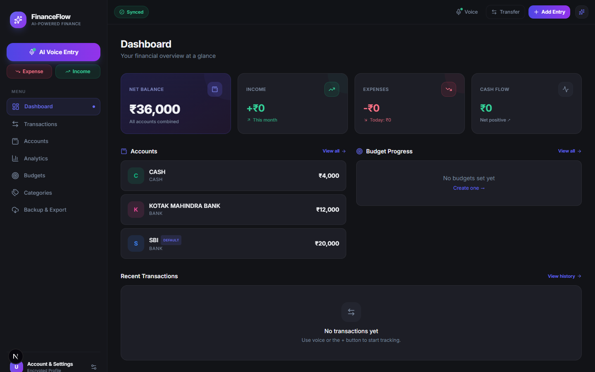
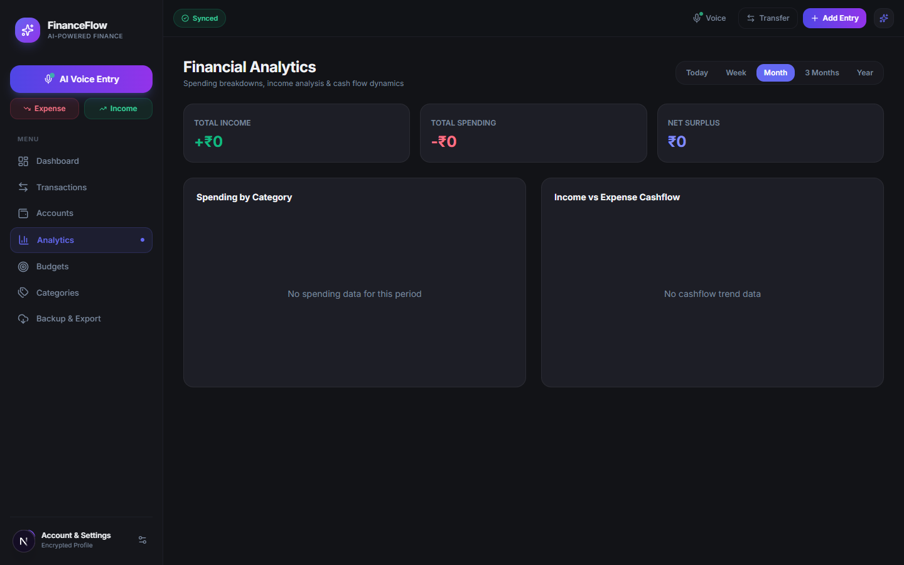
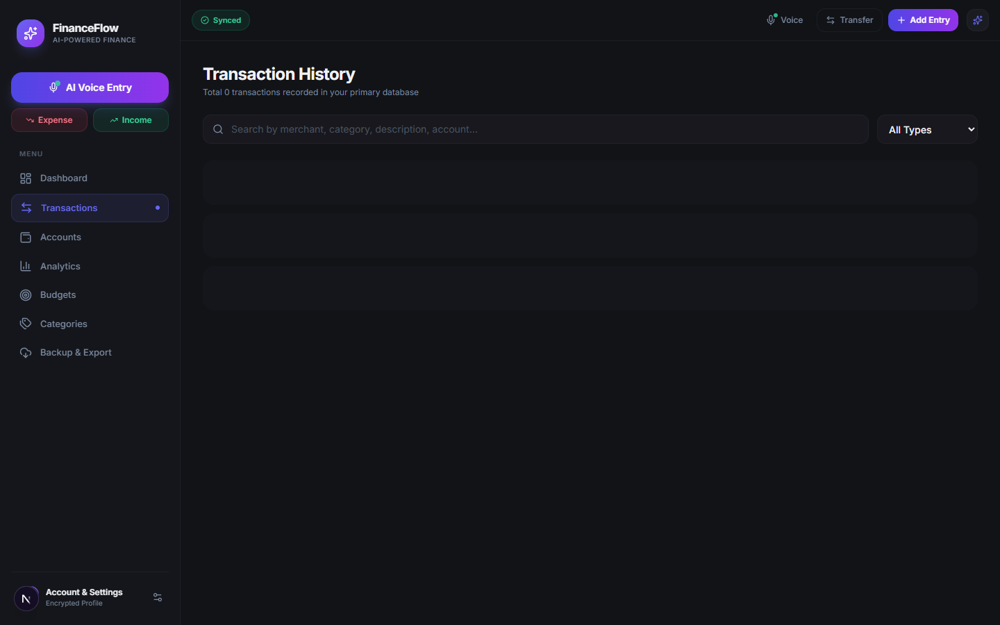
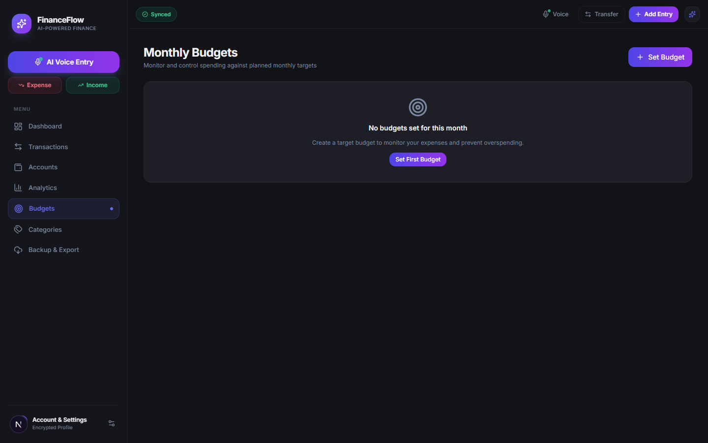
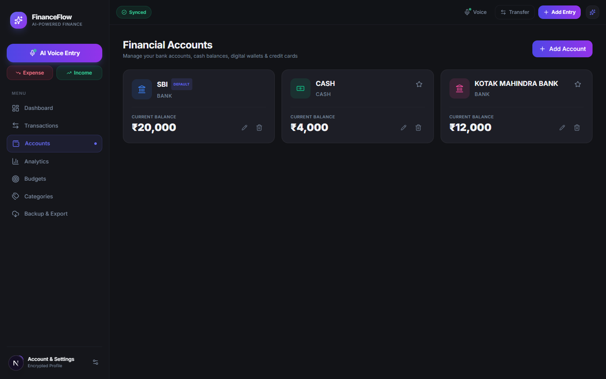
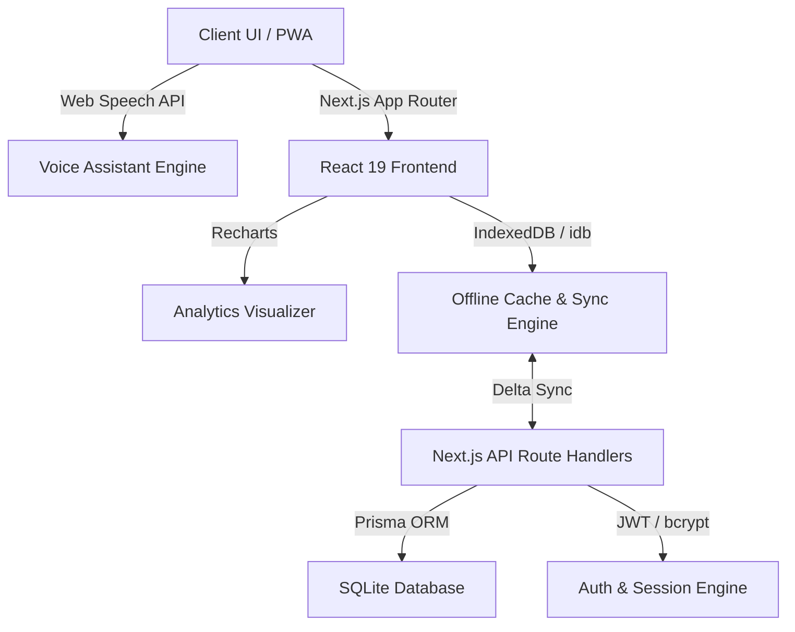
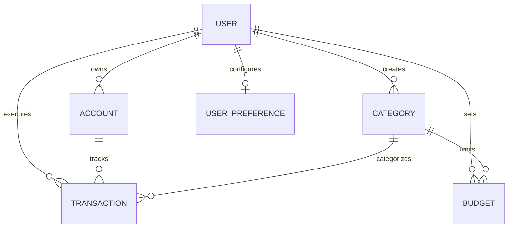

# 💎 FinanceFlow — Personal Finance Management & AI Voice Assistant PWA

[](https://nextjs.org/)
[](https://react.dev/)
[](https://www.typescriptlang.org/)
[](https://tailwindcss.com/)
[](https://www.prisma.io/)
[](https://www.sqlite.org/)
[](https://vitest.dev/)

A modern, production-grade, offline-first personal finance management web application and Progressive Web App (PWA). Features real-time financial analytics, monthly budget tracking, multi-account ledger calculation, an intelligent hands-free AI voice assistant with automatic category guessing, and two-way background synchronization.

---

## 📸 Screenshots & Showcase

### 📊 Dashboard & Financial Overview
Real-time net worth tracking, monthly income vs. expense summary, budget progress bars, and recent activity.


### 📈 Real-Time Analytics & Trends
Interactive visual breakdowns powered by Recharts (Cash Flow, Category Distribution, Monthly Trends).


### 💳 Transaction Ledger & History
Paginated transactions with multi-criteria filtering by account, category, date range, and keyword search.


### 🎯 Monthly Budgets & Spending Limits
Period-based budget limits with visual progress gauges and warning alerts.


### 🏦 Multi-Account Ledger
Comprehensive balance management across Bank accounts, Cash, Digital Wallets, and Credit Cards.


---

## 🌟 Key Features

- **🎙️ Intelligent AI Voice Assistant:**
  - Natural language voice command parsing for instant hands-free transaction logging.
  - **Automatic Category Guessing:** Automatically identifies merchants, dining, groceries, shopping, bills, and transit without interrupting the user.
  - **Single & Multi-Command Parsing:** Supports compound transactions (e.g. *"500 for groceries and 200 for taxi"*).
  - **Conflict & Duplicate Resolution:** Client-side lock and backend idempotency to prevent duplicate entries.
- **💰 Multi-Account Ledger:** Support for Bank accounts, Cash, Wallets, and Credit Cards with real-time balance tracking.
- **🏷️ Smart Categorization & Budgets:** Custom and system categories, monthly spending limits, and live threshold warnings.
- **📊 Interactive Analytics:** In-depth charts powered by Recharts (Income vs. Expense, spending distribution, and category breakdowns).
- **⚡ Offline-First Architecture:** IndexedDB integration (`idb`) enabling full offline functionality with automatic two-way background synchronization when connectivity is restored.
- **🔐 Cross-Device Authentication:** Stateless JWT token authentication with PBKDF2 client derivation, server-side compatibility fallback, and bcrypt password hashing.
- **📱 Progressive Web App (PWA):** Responsive bottom navigation for mobile, desktop sidebar, dark theme, and installable service worker.
- **📁 Data Backup & Import/Export:** Full export/import in CSV and JSON formats with database backup utilities.

---

## 🗣️ Voice Assistant Examples

| What You Say | Action Performed | Category Assigned |
| :--- | :--- | :--- |
| *"Spent 300 on lunch"* | Adds ₹300 Expense | **Dining** (Guessed) |
| *"Paid 450 for groceries using HDFC"* | Adds ₹450 Expense from HDFC Bank | **Groceries** (Guessed) |
| *"Paid 350 to ABC store"* | Adds ₹350 Expense | **Shopping** (Guessed) |
| *"Salary of 50000 came into SBI"* | Adds ₹50,000 Income to SBI Bank | **Salary** |
| *"Move 1000 from HDFC to Cash"* | Transfers ₹1,000 between accounts | **Transfer** |
| *"500 for groceries and 200 for taxi"* | Creates 2 distinct transactions | **Groceries** & **Transport** |
| *"What is my HDFC balance?"* | Answers current account balance | Voice Query Response |

---

## 🏗️ Architecture & Technology Stack



| Layer | Technology |
| :--- | :--- |
| **Framework** | Next.js 15 (App Router) |
| **Frontend** | React 19, TypeScript 5.8, Tailwind CSS, Lucide Icons, Recharts |
| **Backend API** | Next.js Route Handlers (`app/api/`) |
| **Database & ORM** | Prisma ORM 5.22, SQLite (`prisma/dev.db`) |
| **Offline Storage** | IndexedDB (`idb`) & Client Sync Engine (`lib/sync/`) |
| **Security & Auth** | `jose` (JWT), `bcryptjs`, Web Crypto PBKDF2, HttpOnly cookies |
| **Testing** | Vitest 3.2 |

---

## 🗄️ Database Schema

Defined in `prisma/schema.prisma`:



---

## 🚀 Getting Started

### Prerequisites
- **Node.js**: v18.x or higher (Node 20+ recommended)
- **npm**: v9.x or higher

### Installation & Setup

1. **Clone the Repository:**
   ```bash
   git clone https://github.com/ZafarAli001/FinanceFlow.git
   cd FinanceFlow
   ```

2. **Install Dependencies:**
   ```bash
   npm install
   ```

3. **Initialize the Database:**
   ```bash
   npx prisma db push
   ```

4. **Start the Development Server:**
   ```bash
   npm run dev
   ```
   Open [http://localhost:3000](http://localhost:3000) in your browser.

---

## 🔑 Default Demo Account

For quick exploration, a pre-seeded demo user is available:
- **Email:** `demo@finance.app`
- **Password:** `password123`

---

## 🧪 Automated Testing

The project includes unit and integration tests covering voice parsing, multi-segment detection, financial balance integrity, JWT tokens, and cloud sync.

```bash
npm run test
```

---

## 📂 Project Directory Structure

```
FinanceFlow/
├── app/                  # Next.js App Router (Pages & API Routes)
│   ├── accounts/         # Account management page
│   ├── analytics/        # Financial reports & visualizations
│   ├── api/              # Backend API Route Handlers (Auth, AI, Sync, Tx)
│   ├── backup/           # JSON / CSV export and database restore
│   ├── budgets/          # Monthly budget setup & progress
│   ├── categories/       # Category management (Expense & Income)
│   ├── login/            # Authentication login page
│   ├── settings/         # Profile, security, and device settings
│   ├── signup/           # User registration page
│   ├── transactions/     # Transaction list & ledger
│   ├── layout.tsx        # Root layout with PWA shell
│   └── page.tsx          # Main Dashboard
├── components/           # Reusable UI & Feature Components
│   ├── accounts/         # Account cards & creation modal
│   ├── analytics/        # Interactive Recharts visualizers
│   ├── dashboard/        # Summary cards & metrics
│   ├── layout/           # AppShell, Navbar, Sidebar, BottomNav
│   ├── transactions/     # Transaction table & modals
│   ├── ui/               # Button, Modal, Input, Badge primitives
│   └── voice/            # Voice assistant modal & mic visualizer
├── docs/                 # Documentation & Project Media
│   └── screenshots/      # High-resolution application screenshots
├── lib/                  # Application Core Logic & Services
│   ├── ai/               # Voice parser & Natural language queries
│   ├── auth/             # JWT sign/verify & cross-device authentication
│   ├── db/               # Prisma database client singleton
│   ├── finance/          # Account, Transaction, and Budget services
│   ├── sync/             # IndexedDB & background two-way sync
│   └── validation/       # Zod schemas for request validation
├── prisma/               # Prisma ORM schema
│   └── schema.prisma     # SQLite data models & relations
├── public/               # Static assets & PWA files
│   ├── manifest.json     # PWA manifest
│   └── sw.js             # Service Worker for offline caching
└── tests/                # Automated Vitest test suite
```

---

## 📄 License

This project is licensed under the [MIT License](LICENSE).
